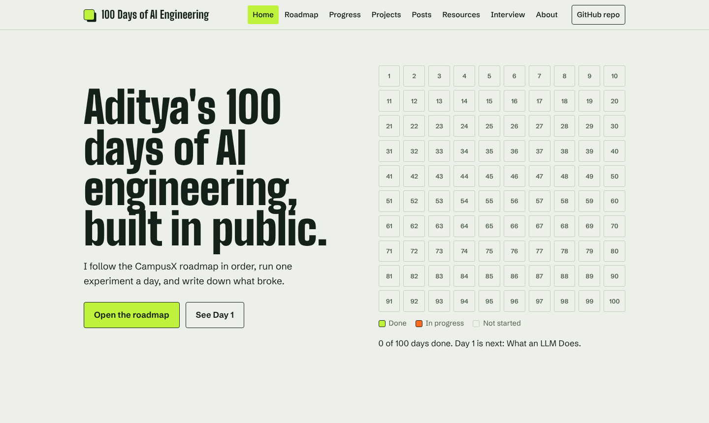

# 100 Days of AI Engineering

Building, evaluating, securing and shipping LLM applications, one documented day at a time.

This repository is my public log of working through the free **[100 Days of AI Engineering roadmap](https://ai-engineer-roadmap-2026.vercel.app/100-days/)** by CampusX. Every day has theory notes in my own words, code that runs, real measurements (tokens, cost, latency, accuracy), and at least one honest failure.

**[Open the live roadmap](https://adityarific.github.io/100-days-of-ai-engineering/)**: the day-by-day path, progress, LinkedIn posts, projects, free resources and interview prep, updated every time a day is finished.

[](https://adityarific.github.io/100-days-of-ai-engineering/)

<!-- PROGRESS:START -->


`░░░░░░░░░░░░░░░░░░░░` **0 / 100 days complete**

| Module | Days | Complete | Page |
| ------ | ---- | -------- | ---- |
| 1. LLM Fundamentals | 1–6 | 0/6 | [Open](modules/01-llm-fundamentals/README.md) |
| 2. Building with LLM APIs | 7–17 | 0/11 | [Open](modules/02-building-with-llm-apis/README.md) |
| 3. Prompt Engineering | 18–24 | 0/7 | [Open](modules/03-prompt-engineering/README.md) |
| 4. RAG | 25–56 | 0/32 | [Open](modules/04-rag/README.md) |
| 5. Agents | 57–83 | 0/27 | [Open](modules/05-agents/README.md) |
| 6. Shipping to Production | 84–100 | 0/17 | [Open](modules/06-shipping-to-production/README.md) |

Full day-by-day table: [PROGRESS.md](PROGRESS.md)
<!-- PROGRESS:END -->

## What this repo is (and isn't)

- **Is:** a structured, verifiable record of learning: notes, experiments, evals and one project that grows across six modules.
- **Isn't:** a copy of anyone's course. The roadmap and the videos belong to their creators; this repo links to them and adds my own notes and code.

## The path

Six modules, followed in order:

1. **LLM Fundamentals** (Days 1–6): how models behave, what they cost, where they fail
2. **Building with LLM APIs** (Days 7–17): LangChain, streaming, structured output, tools, retries, tracing
3. **Prompt Engineering** (Days 18–24): writing, testing, versioning and defending prompts
4. **RAG** (Days 25–56): build, improve, evaluate and secure retrieval
5. **Agents** (Days 57–83): LangGraph, MCP, memory, context, multi-agent, evals and security
6. **Shipping to Production** (Days 84–100): deploy, release safely, monitor, cut cost, fine-tune, security-review

## The roadmap site

A small static site in [`site/`](site/) turns this repository into a personal roadmap you can browse. It is plain HTML, CSS and JavaScript with no build step and no third-party requests (the two fonts are self-hosted).

| Tab | What it shows |
| --- | ------------- |
| Home | Loading screen, the 100-day grid, module progress, latest posts |
| Roadmap | Every day of every module, searchable, with the free sources I use for it |
| Progress | Days done, a finish-date estimate at my pace, and the finished-days table |
| Projects | The running project and the portfolio projects I can choose from |
| Posts | Daily LinkedIn posts and the planned milestone posts |
| Resources | Free sources per module and where CampusX playlists cover it |
| Interview | The 100 interview questions I have answered out loud |
| About | Who I am, the rules of this log and the credits |

It reads `data/*.json`, the same files the tracker writes. When I finish a day and push, a GitHub Actions workflow redeploys the site, so the site and this README always agree.

To preview it locally, run `python -m http.server` in the repository root and open `http://localhost:8000/site/`.

## How each day works

1. Study the day's unit using free resources ([RESOURCES.md](RESOURCES.md)).
2. Write theory notes in my own words (`notes.md`) and export a printable `theory.pdf`.
3. Run the day's experiment and record real numbers in the day's `README.md`.
4. Publish one LinkedIn post, then mark the day done:
   `python scripts/tracker.py done <day> --post <post-url>`

Details and the quality bar: [docs/DAILY_WORKFLOW.md](docs/DAILY_WORKFLOW.md).

## Repository layout

```
.
├── modules/                 one folder per module, one subfolder per day
│   └── 01-llm-fundamentals/
│       └── day-001-.../     README.md · notes.md · theory.pdf · linkedin-post.md · experiments/
├── project/                 the running course project that grows across modules
├── site/                    the roadmap web app (deployed to GitHub Pages)
├── data/                    roadmap, progress, projects, resources (read by the tracker and the site)
├── scripts/tracker.py       creates day folders, marks days done, regenerates progress pages
├── templates/day/           templates copied into every new day
├── docs/                    workflow and quality bar
├── PROGRESS.md              generated day-by-day table
├── RESOURCES.md             free learning resources per module
├── INTERVIEW_PREP.md        roadmap interview questions answered in my own words
└── COST_LOG.md              what the experiments actually cost
```

## Run it yourself

```bash
git clone https://github.com/Adityarific/100-days-of-ai-engineering.git
cd 100-days-of-ai-engineering
python -m venv .venv && source .venv/bin/activate
cp .env.example .env        # then add your own keys; never commit .env
python scripts/tracker.py status
```

Each day's folder lists its own dependencies. Experiments use free tiers or local models (Ollama) wherever possible.

## Safety rules for this public repo

- No API keys, tokens or `.env` files. CI scans every push for secrets.
- No personal data or private documents. Experiments use public or synthetic data.
- No copied course material: notes are written in my own words and sources are linked.

## Credits

- Roadmap: [CampusX, 100 Days of AI Engineering](https://ai-engineer-roadmap-2026.vercel.app/100-days/)
- Free lessons from the [CampusX YouTube channel](https://www.youtube.com/@campusx-official) and the official documentation linked in [RESOURCES.md](RESOURCES.md)
- Notes and code are mine, written with AI assistance for structure and review. I run and understand every experiment I publish.

## About me

Aditya Gupta, a BTech student building toward an AI engineering role. Find me on [GitHub](https://github.com/Adityarific).

## License

[MIT](LICENSE) for the code and notes in this repository. Third-party material keeps its own license.
